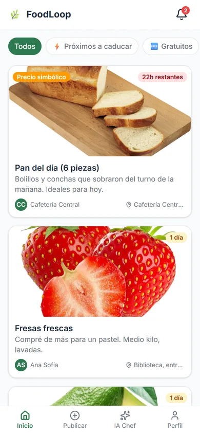
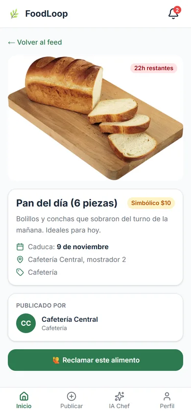
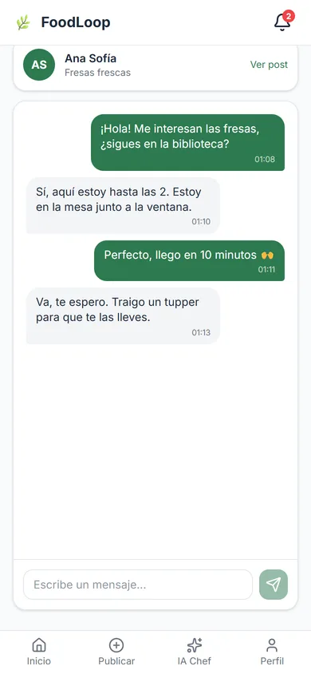
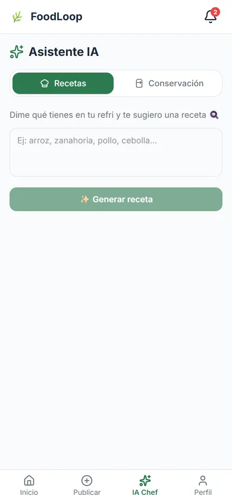
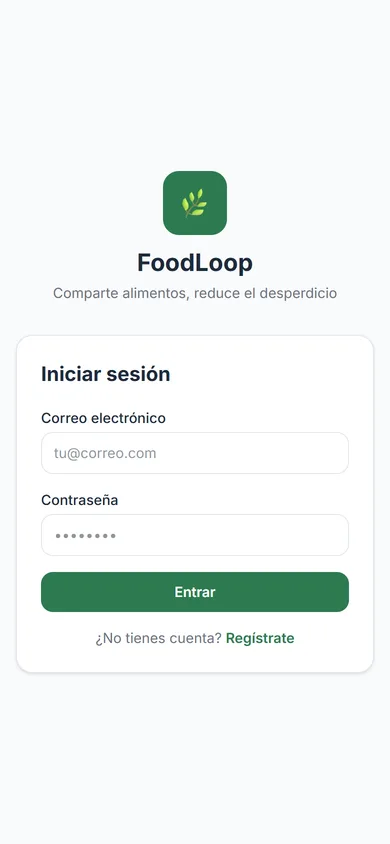
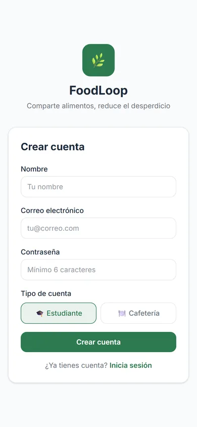
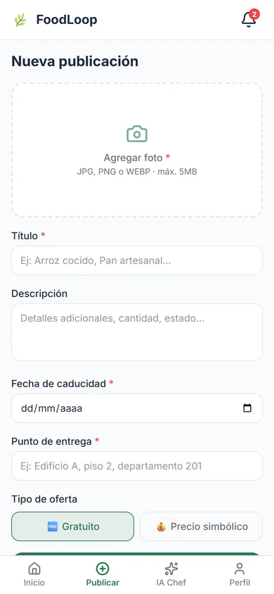
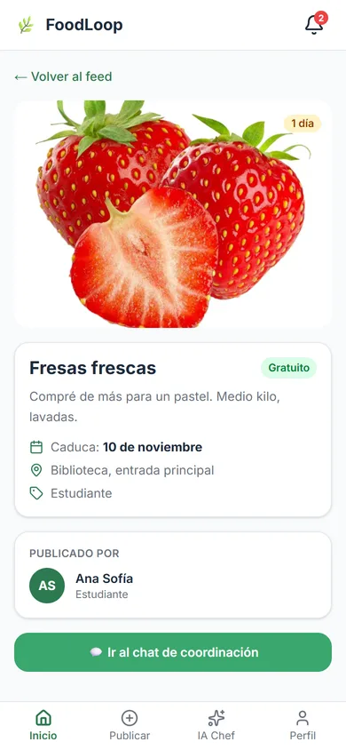
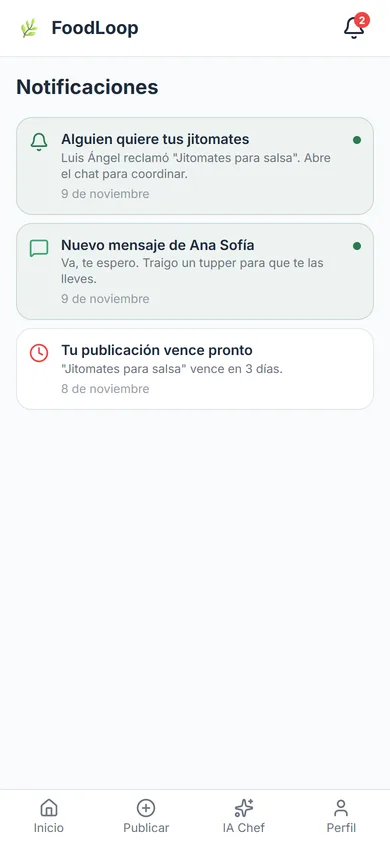
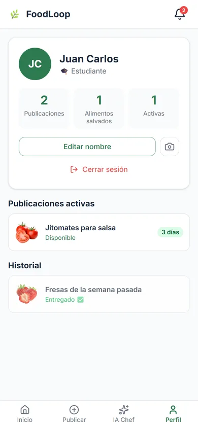

<div align="center">


# FoodLoop

**Share food before it goes to waste.**

*A PWA where a university community posts food that is about to expire, someone claims it, and they arrange the pickup in a real-time chat. An AI chef suggests recipes and storage tips for what you have.*

<a href="https://foodloop-one.vercel.app"></a>

[](https://nextjs.org)
[](https://www.typescriptlang.org)
[](https://supabase.com)
[](https://ai.google.dev)
[](https://tailwindcss.com)
[](#-team)

<br>

&nbsp;
&nbsp;
&nbsp;


</div>

---

## What is FoodLoop?

On a campus, food gets thrown away every day: the cafeteria's leftover bread, fruit someone bought too
much of, ingredients that expire before anyone cooks them. **FoodLoop** connects that food with
someone who can use it:

1. 📸 **Post** the food with a photo, expiration date, pickup point and whether it is free or has a
   symbolic price.
2. 🙋 **Claim** it from the feed before it expires.
3. 💬 **Chat** with the other person in real time to arrange the pickup.
4. ✅ **Mark it as delivered** and it counts as food saved on your profile.

Built in a hackathon by team **Cypher Cosmos** for **DevWeek 26**. The interface is in Spanish.

> **Note:** the demo runs on Supabase's free tier, which pauses inactive projects, so the live site
> may only show the login screen. The screenshots below were taken from a local run with demo data.

---

## 📸 Screenshots

<div align="center">

&nbsp;
&nbsp;
&nbsp;


<br><br>

&nbsp;


</div>

---

## ✨ Features

- 🥗 **Feed** of available food sorted by expiration date, with filters: *expiring soon*, *free* and
  *from the cafeteria*, and a countdown badge on each card.
- 📸 **Post food** with a photo (Supabase Storage), description, expiration date, pickup point and
  offer type: **free** or **symbolic price**.
- 🙋 **Claim** a post with one tap; it disappears from the feed so nobody else goes for it.
- 💬 **Real-time chat** between the person who posted and the one who claimed, with Supabase Realtime.
- 🔔 **Notifications** in real time when someone claims your food or sends you a message, generated by
  database triggers, with an unread counter on the bell.
- 🤖 **AI chef (Gemini)**:
  - **Recipes**: write what you have in the fridge and get a recipe that uses it.
  - **Storage**: ask how to keep a food fresh for longer.
- 👤 **Profiles** for students and cafeterias, with avatar, active posts, history and a
  *food saved* counter.
- ✅ **Post lifecycle**: available → claimed → delivered (or expired).
- 📱 **PWA**: installable on phone and desktop, made mobile first.
- 🔐 **Row-level security** in PostgreSQL so each user can only change what is theirs.

---

## 🛠️ Tech Stack

| Layer | Technology |
| :--- | :--- |
| **Framework** | Next.js 16 (App Router, Server Components, Route Handlers) |
| **Language** | TypeScript |
| **Styling** | Tailwind CSS 4 |
| **Database** | Supabase PostgreSQL with RLS and triggers |
| **Auth** | Supabase Auth (email and password) with `@supabase/ssr` |
| **Storage** | Supabase Storage (`post-images`, `avatars`) |
| **Real time** | Supabase Realtime (chat and notifications) |
| **AI** | Google Gemini (`gemini-3.1-flash-lite`) |
| **Hosting** | Vercel |

---

## 🏗️ Project Structure

```
foodloop/
├── src/
│   ├── app/
│   │   ├── (auth)/          # login, register
│   │   ├── (app)/           # feed, feed/[id], new-post, chat/[claimId], notifications, profile, ai
│   │   └── api/             # auth (profile), ai (recipe, storage)
│   ├── components/
│   │   ├── feature/         # PostCard, FeedFilters, ClaimButton, ChatPanel, NotificationBell…
│   │   └── ui/              # Base components
│   ├── lib/
│   │   ├── supabase/        # Server and browser clients
│   │   ├── gemini.ts        # Gemini wrapper
│   │   └── types.ts         # Domain types
│   └── middleware.ts        # Session refresh and route protection
├── supabase/
│   ├── schema.sql           # Tables, enums, RLS, triggers
│   └── seed.sql             # Sample data
└── public/                  # PWA manifest, icons and service worker
```

---

## 🚀 Getting Started

### Prerequisites
- Node.js 18+
- A [Supabase](https://supabase.com) project
- A [Google AI Studio](https://aistudio.google.com) API key

### Setup

```bash
git clone https://github.com/NotJcao17/foodloop.git
cd foodloop/foodloop
npm install
```

Create `.env.local`:

```env
NEXT_PUBLIC_SUPABASE_URL=https://your-project.supabase.co
NEXT_PUBLIC_SUPABASE_ANON_KEY=your_anon_key
SUPABASE_SERVICE_ROLE_KEY=your_service_role_key
GEMINI_API_KEY=your_gemini_api_key
```

Run `supabase/schema.sql` in the Supabase SQL editor and create two **public** Storage buckets:
`post-images` and `avatars`. Then:

```bash
npm run dev        # http://localhost:3000
```

---

## 👥 Team

**Cypher Cosmos** · DevWeek 26
